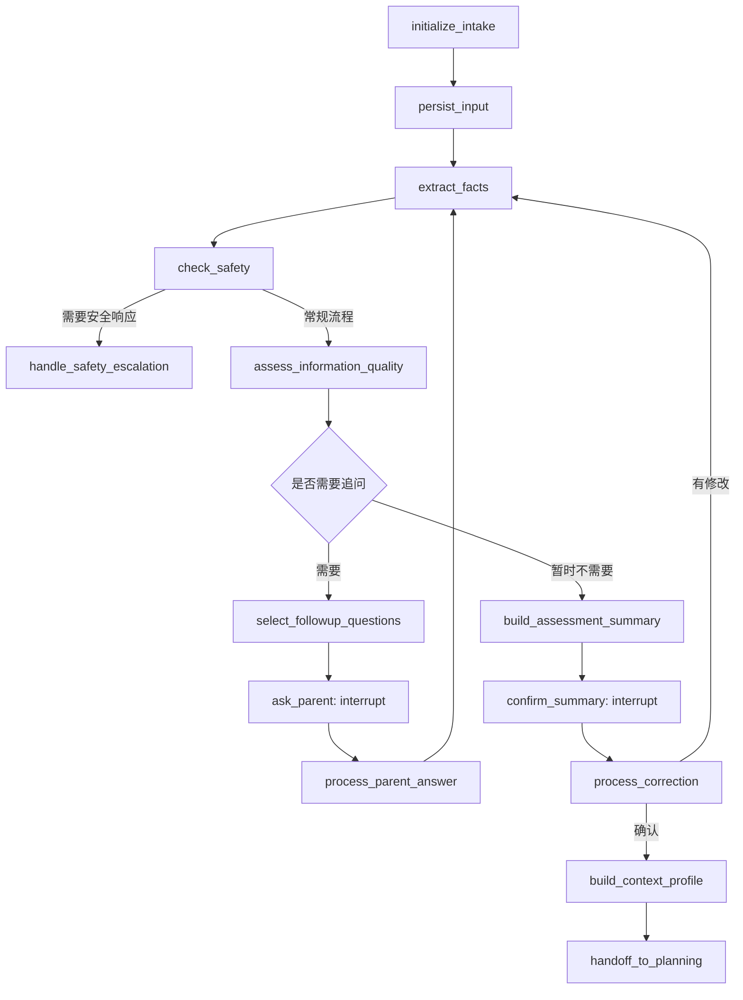

> ⚠️ **已归档（2026-10-21）**。这是当天早些时候的「初次评估图」需求稿，
> 已被同日的 `refract.md`（案例级重构总方案）与 `asd_agent/REFACTOR.md`（分阶段执行文档）取代。
> 它的**有价值的部分已被吸收**：多轮追问与停止条件 → `REFACTOR.md` A.3.5；
> 事实/未知/冲突三类信息 → A.3.2 证据模型；安全检查 → A.3.3。
> 但**表名与接口名不一致**（本文的 `intake_sessions` / `intake_facts` / `intake_questions` vs
> 新方案的 `cases` / `case_evidence` / `assessment_versions`），**不要照着本文档实现**。

# `intake_assessment_graph` 初次评估图需求文档

**文档版本：** V1.0  
**产品模块：** 孤独症家庭支持智能体  
**模块名称：** 初次评估与自适应追问  
**技术框架：** LangGraph + Python + FastAPI + PostgreSQL / Supabase  
**文档状态：** 需求设计稿

---

## 1. 项目背景

### 1.1 背景说明

孤独症家庭支持智能体需要根据家长提供的儿童日常表现，逐步了解孩子的具体情况，形成结构化的情境画像，并为后续的个性化家庭支持计划提供可靠输入。

然而，家长在初次使用系统时，通常存在以下情况：

1. **描述零散：** 只描述一个现象，例如“孩子在幼儿园不合群”。
2. **表达不规范：** 使用“任性”“不听话”“不配合”等主观评价，缺少具体行为描述。
3. **关键信息缺失：** 没有说明发生场景、前因后果、频率和持续时间。
4. **信息来源不一致：** 部分情况来自家长亲自观察，部分来自幼儿园老师转述。
5. **存在不确定性：** 家长可能不知道孩子当时的想法，也不清楚某种表现的原因。
6. **需要逐步回忆：** 家长可能在后续对话中才想起重要细节，或者修正之前的描述。
7. **缺乏专业知识：** 家长不知道哪些信息对后续支持方案有帮助。

如果系统直接根据第一轮输入生成支持计划，容易过早下结论，或者遗漏影响方案选择的重要信息。

因此，需要建立独立的初次评估流程，通过结构化信息抽取、缺口识别、自适应追问、家长确认和初步分析，逐步形成可追溯、可修正的评估结果。

### 1.2 产品目标

本模块需要实现：

- 接受家长自然、零散、非专业的描述。
- 将自然语言转化为结构化信息，同时保留原始表达。
- 区分已报告事实、模型推测、未知信息和冲突信息。
- 根据当前信息缺口动态生成追问，而不是机械地完成固定问卷。
- 支持家长回答“不清楚”“跳过”或自由补充。
- 允许家长检查、修改并确认结构化摘要。
- 生成带有不确定性说明的初步情境画像。
- 将必要的结构化结果交给后续支持计划模块。
- 支持 LangGraph 中断、恢复、历史追溯和业务审计。

### 1.3 非目标

本模块不负责：

- 诊断或排除孤独症及其他发育障碍。
- 仅凭家长的简短描述判断行为的真实原因。
- 替代医生、心理专业人员或其他具备相应资质的专业人员进行评估。
- 自动将模型生成的假设保存为已确认事实。
- 在信息不足时强行生成确定性的干预计划。
- 自动决定孩子是否已经取得临床意义上的进步。
- 在常规追问流程中处理紧急危险事件；此类情况应转入独立的安全响应流程。

---

## 2. 用户与使用场景

### 2.1 目标用户

主要用户为需要记录、理解和支持孩子日常发展的家长或监护人。

用户不应被要求掌握专业术语，也不应因为无法准确描述孩子的表现而无法继续使用系统。

### 2.2 核心使用场景

家长首次进入系统，输入：

> 我家孩子在幼儿园不太听老师的话，集体活动的时候总是自己待着，别的小朋友靠近他就哭。

系统需要：

1. 理解家长描述的主要问题。
2. 提取当前已知信息。
3. 识别尚不清楚的关键情况。
4. 选择最有助于后续分析的问题。
5. 根据家长回答继续更新信息。
6. 在信息足够时生成摘要。
7. 邀请家长确认或修正。
8. 生成初步情境画像，并说明哪些问题仍然无法确定。

系统不应仅凭“自己待着”和“哭”就认定孩子存在社交障碍、感官敏感或不服从行为。

---

## 3. 整体业务流程

### 3.1 主流程

```text
家长首次描述
    ↓
创建初次评估会话
    ↓
接收并保存原始输入
    ↓
结构化信息抽取
    ↓
安全风险检查
    ↓
信息质量检查与缺口识别
    ↓
判断是否需要继续追问
    ├── 需要追问
    │      ↓
    │   生成追问问题
    │      ↓
    │   等待家长回答
    │      ↓
    │   保存回答并更新信息
    │      ↓
    │   重新检查安全与信息缺口
    │
    └── 暂无必要追问
           ↓
        生成评估摘要
           ↓
        家长确认、修改或补充
           ↓
        生成初步情境画像
           ↓
        保存评估版本
           ↓
        交接后续支持计划模块
```

### 3.2 流程设计原则

1. 信息抽取与原因判断分离。
2. 安全检查优先于常规追问。
3. 每轮追问应有明确的信息收集目的。
4. 不要求所有字段完整才能完成评估。
5. 家长可以随时补充、修改或结束评估。
6. 家长未确认的摘要不得标记为正式确认结果。
7. 追问结束不代表所有不确定性均已消除。
8. 评估完成与后续计划审批是两个不同的业务环节。

---

## 4. 功能需求

### FR-01：接收家长自然语言输入

**优先级：P0**

系统应支持家长通过自然语言描述孩子的情况，不要求使用固定格式。

输入内容可以包含：

- 一个或多个行为现象。
- 多个不同的生活场景。
- 家长的主观判断。
- 其他人的转述。
- 时间、频率或程度等模糊描述。
- 对先前信息的补充或更正。

系统应保留原始输入，并为每条输入分配唯一的业务记录 ID。

如果未来支持语音输入，应区分原始语音、转写文本和模型提取结果。

**验收标准：**

- 输入“孩子不听话”，系统可以继续分析和追问，而不是要求用户重写。
- 输入多件事情时，系统可以提取多个观察事项。
- 原始文本不会因为结构化整理而被覆盖。
- 同一段输入被重复提交时，可以通过幂等机制避免重复创建相同业务记录。

### FR-02：结构化信息抽取

**优先级：P0**

系统应将家长的描述提取为标准化的观察记录。

建议每条观察至少包含以下字段：

| 字段 | 说明 |
|---|---|
| `observation_id` | 观察记录 ID |
| `behavior_description` | 可观察到的具体表现 |
| `context` | 发生的场景 |
| `antecedent` | 行为发生前的情况 |
| `behavior` | 行为本身 |
| `consequence` | 行为之后发生的情况 |
| `frequency` | 发生频率 |
| `duration` | 持续时间 |
| `onset` | 开始出现的时间 |
| `source_type` | 亲自观察、老师转述、其他来源 |
| `source_message_ids` | 对应的原始消息 ID |
| `certainty_status` | 信息确定性状态 |
| `parent_confirmed` | 家长是否确认该条信息 |

上述字段不要求一次全部填满。系统应允许部分字段为空。

特别要求：

- “孩子不听话”应保留为家长原始描述，并尝试追问具体行为。
- “老师说孩子不参与活动”应记录为老师转述，而非家长亲自观察。
- “孩子可能害怕其他小朋友”应记录为待验证假设，而非事实。
- 不得把模型推测直接写入已确认的观察记录。

### FR-03：信息状态管理

**优先级：P0**

每个信息字段应支持以下状态：

| 状态 | 含义 |
|---|---|
| `known` | 已从输入中提取到明确报告内容，但不代表已经独立验证 |
| `inferred` | 模型推断，尚未得到家长确认 |
| `unknown` | 当前没有足够信息 |
| `conflicting` | 不同输入之间存在冲突 |
| `not_applicable` | 该字段不适用于当前场景 |

需要注意：`known` 表示“已知家长报告了什么”，并不代表该报告已被外部验证。

模型推测应有独立的记录结构，至少包含推测内容、依据、关联观察和待验证状态。

家长确认后，也应保留信息来源和确认时间，不能把确认状态理解为临床事实验证。

### FR-04：信息缺口识别

**优先级：P0**

结构化抽取后，系统应识别影响后续支持方案的关键信息缺口。

优先考虑以下维度：

1. 当前最希望解决的问题。
2. 行为发生的具体场景。
3. 可观察到的行为表现。
4. 发生前的环境或事件。
5. 行为发生后的成人回应及孩子变化。
6. 发生频率、持续时间和近期变化。
7. 孩子的沟通方式与当时的表达。
8. 已尝试的支持方法及反应。
9. 家庭与学校环境中的差异。
10. 可能影响安全和基本需要的信息。

缺口识别不等于要求所有字段都必须补齐。系统应优先选择会改变后续分析或支持方式的信息。

### FR-05：自适应追问生成

**优先级：P0**

系统应根据当前信息缺口生成针对性问题。

初始设计要求：

- 每轮通常提出 1–3 个问题。
- 通常在 2–4 轮后重新评估是否已经具备进入下一阶段的条件。
- 允许问题数量根据实际情况调整。
- 避免重复询问已经明确且经过确认的信息。
- 允许家长选择“不清楚”“跳过”或输入自由文本。
- 允许家长补充当前问题以外的重要信息。
- 每个问题都必须关联一个或多个待澄清的信息字段。
- 不得为了填满所有字段而无限追问。

系统内部应为每个候选问题计算或评估：

- 对下一步决策的影响。
- 当前信息缺失程度。
- 是否存在更优先的问题。
- 家长回答的难度。
- 是否涉及敏感或高风险内容。
- 是否已经被其他回答间接解决。

最终问题排序可以由规则与模型共同完成。

**示例：**

家长描述：

> 孩子在集体活动时不听老师的话，其他小朋友靠近就哭。

合理的第一轮追问可以是：

1. 小朋友靠近时，孩子通常是躲开、哭泣、推开对方，还是有其他表现？
2. 老师提出活动要求时，孩子通常能理解并开始做吗？
3. 这种情况是最近才出现，还是已经持续了一段时间？

系统应根据家长回答决定下一轮是否继续询问，而不是提前生成固定的完整问卷。

### FR-06：追问停止与退出

**优先级：P0**

系统需要支持以下情况：

- 信息已足够支持初步情境分析。
- 继续追问不会显著改变下一步决策。
- 家长明确表示不知道。
- 家长跳过某些问题。
- 家长暂时不想继续。
- 已达到追问轮数建议上限。
- 存在尚未解决的重大信息冲突。
- 出现需要优先处理的安全问题。

达到轮数建议上限时，系统应重新判断，而不是强制结束或强制继续。

如果信息仍不完整，系统可以形成有限的初步画像，明确列出未知项，并在适当时建议专业评估。

### FR-07：安全检查

**优先级：P0**

系统应在初始输入处理阶段执行安全检查，并在后续补充信息时重新执行。

安全检查应识别可能需要优先处理的情况，例如：

- 孩子或他人面临即时危险。
- 明显的伤害风险。
- 家长描述中存在需要及时关注的严重健康或安全问题。
- 当前情况可能超出常规家庭支持的适用范围。

安全规则不应完全依赖大模型自由判断。应采用确定性规则、模型辅助识别和必要的人工处理机制。

触发安全流程时：

1. 暂停普通的追问与计划生成路径。
2. 根据经过审核的安全策略提供适当的行动指引。
3. 在必要时建议联系当地紧急服务或专业人员。
4. 保存安全事件及处理状态。
5. 不应为了完成初次评估而延误必要的安全响应。

具体风险分类、触发条件和响应文案应作为独立的安全策略配置管理，并经专业人员审核。

### FR-08：冲突信息处理

**优先级：P0**

当不同来源的信息不一致时，系统不得自行选择其中一个版本作为最终事实。

例如：

- 家长认为孩子在家可以理解指令。
- 老师反馈孩子在幼儿园很难跟上集体指令。

系统应先判断两条信息是否确实矛盾，也可能只是场景不同。

处理要求：

1. 保留各自的来源和时间。
2. 识别冲突属于事实冲突、时间变化还是场景差异。
3. 对影响后续决策的冲突生成澄清问题。
4. 无法澄清时保留冲突状态。
5. 不得覆盖或删除先前的原始记录。

### FR-09：生成评估摘要

**优先级：P0**

当信息足以进入摘要阶段时，系统应生成家长能够理解的结构化摘要。

建议包括：

1. 家长当前最关心的问题。
2. 已报告的主要观察事实。
3. 行为发生的主要场景。
4. 已知的前因与后续情况。
5. 孩子已经表现出的能力、兴趣或有效支持方式。
6. 目前仍不明确的信息。
7. 不同来源之间尚未解决的差异。
8. 模型提出的待验证假设。
9. 下一步建议重点了解的方向。

摘要应采用通俗语言，避免未经证实的病理化解释。

### FR-10：家长确认与修正

**优先级：P0**

系统生成摘要后，必须允许家长：

- 确认摘要基本符合实际。
- 修改某条信息。
- 补充新的情况。
- 指出某条信息来自老师或其他人。
- 说明某个推测并不符合实际。
- 暂时不确认。

家长修改信息后，系统应重新处理受到影响的字段和结论。

家长确认摘要，不等于确认系统提出的全部假设。

如果家长未确认，系统不得把摘要标记为正式确认结果；是否允许继续生成低风险的初步建议，应由产品策略决定，并明确提示其为未确认版本。

### FR-11：生成初步情境画像

**优先级：P0**

家长确认后，系统应生成供后续支持计划模块使用的结构化结果。

该结果至少包含：

- 当前问题和家长目标。
- 已确认的家长报告信息。
- 未解决的信息缺口。
- 冲突信息及来源。
- 待验证的可能解释。
- 孩子的能力、兴趣和已有支持资源。
- 适用的风险标记。
- 进入后续支持计划阶段的建议条件。

该画像不是诊断报告，也不是自动生成的临床评估结论。

### FR-12：知识检索接口

**优先级：P1**

本模块可以调用经过审核的专业知识 RAG，用于：

- 识别需要进一步了解的信息维度。
- 为追问提供经过审核的参考依据。
- 解释专业概念。
- 在评估摘要中区分一般性知识与个体观察。

RAG 不得：

- 将知识库中的一般结论转换为当前孩子的已确认事实。
- 替代业务数据库中的家长记录。
- 在没有证据支持时自动生成确定性解释。
- 让未经审核的来源覆盖系统安全规则。

当检索不到可靠依据时，应允许系统明确表示暂无足够依据。

---

## 5. LangGraph 工作流设计

### 5.1 节点设计

建议建立以下节点：

| 节点 | 主要职责 |
|---|---|
| `initialize_intake` | 初始化评估会话及工作流上下文 |
| `persist_input` | 保存原始输入并执行幂等检查 |
| `extract_facts` | 抽取结构化信息 |
| `check_safety` | 检查安全风险 |
| `assess_information_quality` | 识别缺失、冲突和不确定字段 |
| `select_followup_questions` | 排序并选择下一轮追问 |
| `ask_parent` | 通过 `interrupt()` 等待家长回答 |
| `process_parent_answer` | 保存回答并更新信息 |
| `build_assessment_summary` | 生成评估摘要 |
| `confirm_summary` | 通过 `interrupt()` 等待家长确认或修改 |
| `process_correction` | 处理修改、补充和事实更正 |
| `build_context_profile` | 生成结构化情境画像 |
| `handoff_to_planning` | 交接后续支持计划模块 |
| `handle_safety_escalation` | 执行安全响应分支 |

### 5.2 工作流结构



该流程为逻辑设计。实际实现时，需要为家长跳过问题、结束评估、摘要暂不确认、出现冲突和安全升级等情况配置明确的路由。

### 5.3 中断恢复要求

使用 LangGraph 的 `interrupt()` 实现等待家长回复和摘要确认。

要求：

- 恢复时使用原有 `thread_id`。
- 每次等待输入前，持久化必要的业务状态。
- 恢复后正确读取家长的回复，不重复处理之前的输入。
- 节点可能在中断恢复时重新执行，因此外部副作用必须具备幂等性。
- 不得因为工作流重试而重复创建观察记录、问题记录或摘要版本。
- 记录实际使用的 `graph_version`，为后续工作流升级提供依据。
- checkpoint 用于工作流状态恢复，业务数据库用于保存正式的评估记录和确认结果。

### 5.4 推荐 State 结构

```python
from typing import Any, TypedDict


class IntakeState(TypedDict, total=False):
    # 业务身份
    intake_id: str
    child_id: str
    case_id: str
    branch_id: str

    # 当前输入
    current_message_id: str
    current_user_message: str
    raw_messages: list[dict[str, Any]]

    # 信息抽取
    extracted_facts: dict[str, Any]
    unresolved_questions: list[dict[str, Any]]
    conflicting_facts: list[dict[str, Any]]
    hypotheses: list[dict[str, Any]]

    # 追问管理
    current_question_batch: list[dict[str, Any]]
    clarification_round: int
    max_recommended_rounds: int
    parent_skipped_fields: list[str]
    intake_status: str

    # 安全状态
    safety_flags: list[dict[str, Any]]
    safety_status: str

    # 摘要及确认
    assessment_summary: dict[str, Any]
    summary_version: int
    parent_confirmed: bool
    confirmation_status: str

    # 评估结果
    context_profile: dict[str, Any]
    handoff_status: str
```

State 只保留当前工作流需要的上下文，不应塞入孩子的全部长期历史。需要时从业务数据库按权限读取。

`max_recommended_rounds` 是建议性参数，而不是强制终止开关。

---

## 6. 业务数据模型

建议将业务记录与 LangGraph checkpoint 分开存储。

### 6.1 `intake_sessions`

记录一次初次评估会话。

字段建议：

- `id`
- `child_id`
- `case_id`，允许为空
- `status`
- `current_round`
- `started_at`
- `completed_at`
- `created_by`
- `created_at`
- `updated_at`

状态建议：

- `collecting`
- `awaiting_parent_answer`
- `awaiting_confirmation`
- `confirmed`
- `completed`
- `paused`
- `safety_escalated`
- `abandoned`

### 6.2 `intake_messages`

保存会话中的原始输入和系统提问。

字段建议：

- `id`
- `intake_id`
- `role`
- `content`
- `message_type`
- `source_type`
- `created_at`

原始输入原则上只追加，不因后续结构化整理而覆盖。

### 6.3 `intake_facts`

保存结构化观察事实。

字段建议：

- `id`
- `intake_id`
- `fact_type`
- `fact_content`
- `certainty_status`
- `source_message_ids`
- `source_type`
- `parent_confirmation_status`
- `supersedes_fact_id`
- `created_at`
- `updated_at`

事实更正应创建更正记录或新版本，并保留原始记录及其历史关系。

### 6.4 `intake_questions`

保存系统生成的追问。

字段建议：

- `id`
- `intake_id`
- `question_text`
- `target_fields`
- `reason`
- `priority`
- `status`
- `round_number`
- `created_at`

状态建议：

- `pending`
- `answered`
- `skipped`
- `superseded`
- `cancelled`

### 6.5 `intake_answers`

保存家长回答。

字段建议：

- `id`
- `intake_id`
- `question_id`
- `answer_text`
- `answer_type`
- `source_message_id`
- `created_at`

同一轮中，家长的自由补充也应能关联到会话，而不必强行绑定到某个问题。

### 6.6 `assessment_summaries`

保存评估摘要版本。

字段建议：

- `id`
- `intake_id`
- `version`
- `summary_content`
- `unknowns`
- `conflicts`
- `hypotheses`
- `confirmation_status`
- `confirmed_by`
- `confirmed_at`
- `created_at`

每次实质性修改都应生成新版本，不能覆盖已经确认的历史摘要。

### 6.7 `workflow_runs`

记录 LangGraph 的业务运行信息。

字段建议：

- `id`
- `intake_id`
- `thread_id`
- `checkpoint_ns`
- `checkpoint_id`
- `graph_version`
- `status`
- `started_at`
- `finished_at`

`workflow_run_id`、`intake_id`、`thread_id` 和 `checkpoint_id` 含义不同，不得互相替代。

---

## 7. 接口需求

具体接口名称可根据现有 FastAPI 项目调整。

### 7.1 创建评估会话

`POST /api/intake-sessions`

请求示例：

```json
{
  "child_id": "child-001",
  "initial_message": "孩子在幼儿园不太听老师的话，其他小朋友靠近就哭。"
}
```

响应至少包含：

```json
{
  "intake_id": "intake-001",
  "status": "awaiting_parent_answer",
  "assistant_message": "我想先了解一下当时的具体情况……",
  "questions": [],
  "summary": null
}
```

以上 ID 和响应内容仅为示例。

### 7.2 提交回答或补充信息

`POST /api/intake-sessions/{intake_id}/messages`

请求示例：

```json
{
  "message": "主要是集体坐一圈的时候，老师单独陪着就好一些。",
  "reply_to_question_id": null
}
```

系统应保存输入，并更新对应的结构化信息和工作流状态。

### 7.3 获取当前评估状态

`GET /api/intake-sessions/{intake_id}`

返回：

- 当前评估状态。
- 当前追问轮次。
- 当前待回答问题。
- 已整理的家长报告信息。
- 尚未解决的关键信息缺口。
- 是否需要家长确认。

### 7.4 确认或修正摘要

`POST /api/intake-sessions/{intake_id}/confirm`

请求示例：

```json
{
  "action": "edit",
  "edits": [
    {
      "field": "context",
      "value": "主要发生在集体围坐活动中。"
    }
  ]
}
```

`action` 可支持 `confirm`、`edit`、`not_ready` 等值。

修改后应重新评估受到影响的信息，并生成新的摘要版本。

### 7.5 完成评估

`POST /api/intake-sessions/{intake_id}/complete`

仅允许在符合业务完成条件时执行。完成评估并不意味着必须立即创建干预计划。

所有接口都应实施身份认证、对象级授权、请求校验、限流及幂等保护。

---

## 8. 初步评估输出格式

建议将最终输出分成“家长可读摘要”和“供后续工作流使用的结构化数据”两部分。

示例：

```json
{
  "intake_id": "intake-001",
  "assessment_status": "parent_confirmed",
  "parent_goal": {
    "value": "希望孩子更舒适地参与幼儿园集体活动",
    "status": "known"
  },
  "observations": [
    {
      "description": "孩子在集体围坐活动中较难参与",
      "source_type": "teacher_reported",
      "certainty_status": "known"
    },
    {
      "description": "老师单独陪伴时，孩子能够进行简单的故事问答",
      "source_type": "teacher_reported",
      "certainty_status": "known"
    }
  ],
  "unknowns": [
    "孩子在集体活动中难以参与的具体原因尚不明确",
    "同伴靠近时的具体行为及前后情境仍需进一步了解"
  ],
  "hypotheses": [
    {
      "content": "集体活动与一对一活动的要求或环境可能存在差异",
      "status": "unverified"
    }
  ],
  "recommendation_readiness": "ready_for_initial_support_planning"
}
```

示例内容只是格式演示，不代表真实孩子的评估结论。

`recommendation_readiness` 仅表示是否具备进入初步支持计划阶段的条件，不表示临床评估已经完成。

---

## 9. 非功能需求

### 9.1 可追溯性

- 每条结构化事实必须能追溯到原始输入或明确的数据来源。
- 每个追问必须能追溯到对应的信息缺口。
- 每个摘要版本必须能追溯到生成时使用的信息版本。
- 家长更正、确认和撤回操作应保留审计记录。

### 9.2 可靠性

- 工作流支持中断和恢复。
- 外部写操作必须具备幂等性。
- 网络超时或模型调用失败时，不得丢失已经保存的家长输入。
- 工作流失败后能够从持久化状态恢复。
- 业务数据库与 checkpointer 状态不一致时，应支持检测和对账。

### 9.3 隐私与权限

- 只收集完成评估所必需的信息。
- 儿童信息应实施严格的访问控制。
- 传输与存储应采取适当的加密措施。
- 支持按适用法律和产品政策处理数据导出、更正和删除请求。
- 不应将可识别的儿童信息无必要地发送给外部模型或写入应用日志。
- 明确儿童信息的保留周期和删除策略。

### 9.4 可维护性

- 追问策略、停止条件和安全规则应可配置。
- 提示词、知识库版本和图定义版本应可追踪。
- 更换模型不应导致业务数据模型必须重建。
- 不同版本的评估流程应具备回归测试。

---

## 10. 异常情况处理

| 异常情况 | 处理方式 |
|---|---|
| 家长只输入一句话 | 先提取有限信息，再询问最重要的缺口 |
| 家长连续补充多个场景 | 拆分为多个观察记录，不丢失来源关系 |
| 家长回答“不知道” | 标记为未知，不重复逼问 |
| 家长跳过问题 | 标记为跳过，继续评估是否可以推进 |
| 信息存在矛盾 | 保留双方信息并尝试澄清 |
| 家长更正以前的描述 | 保留原始记录，建立更正关系 |
| 模型生成无关问题 | 根据目标字段、问题相关性和重复检查进行过滤 |
| 检索不到可靠知识 | 不编造依据，明确说明不确定性 |
| 模型调用失败 | 保存输入和当前进度，允许重试 |
| 中断恢复后重复执行 | 通过幂等键避免重复写入 |
| 触发安全规则 | 转入安全响应流程，暂停常规评估路径 |
| 家长中途退出 | 保存当前状态，允许以后继续或按政策关闭会话 |

---

## 11. 验收标准

### AC-01：零散输入处理

给定家长输入“孩子不听话”，系统应能够保存原始描述、识别信息不足，并生成至少一个与具体行为有关的澄清问题。

### AC-02：事实与推测分离

给定家长输入“其他小朋友靠近时孩子哭”，系统不得直接把“害怕社交”写为已确认事实。

### AC-03：自适应追问

当家长已经明确某个字段时，系统应避免重复询问同一信息；当回答引出新的重要缺口时，允许生成下一轮追问。

### AC-04：允许跳过

家长回答“不清楚”或跳过问题后，系统应保留未知状态，不得自动填入推测值。

### AC-05：冲突处理

当家长与老师的报告不一致时，系统应保留各自来源，不得静默覆盖其中一方。

### AC-06：摘要确认

系统生成摘要后，家长应能够确认、修改或暂不确认。修改后应生成新版本，并重新评估相关信息。

### AC-07：中断恢复

在追问节点发生中断后，重新恢复工作流不应重复创建相同的问题或观察记录。

### AC-08：安全优先

当输入触发已配置的高优先级安全规则时，系统应进入对应安全处理路径，而不是继续普通追问。

### AC-09：信息不足时的克制

当关键问题无法澄清时，系统应保留不确定性，不得为了满足流程而生成确定性的原因判断。

### AC-10：结果可追溯

每条输出中的已报告事实应能追溯到原始消息，每个模型假设应有独立标识，所有摘要版本和家长确认记录均可查询。

### AC-11：安全与隐私

未经授权的用户不得访问其他孩子的评估记录；日志中不得无必要地暴露儿童敏感信息。

### AC-12：后续模块交接

评估达到完成条件后，系统应输出规定的结构化情境画像，供支持计划模块使用；不应将未经确认的内容伪装成已确认信息。

---

## 12. 测试方案

MVP 阶段应建立覆盖以下场景的测试集：

1. 一句话描述。
2. 多条零散信息连续输入。
3. 使用主观、模糊或带偏见的描述。
4. 家长转述老师意见。
5. 家长不知道答案。
6. 家长跳过部分问题。
7. 家长补充与原描述不同的情况。
8. 家长修正已确认信息。
9. 同一场景存在不同来源的报告。
10. 追问节点中断与恢复。
11. 模型服务超时或返回格式错误。
12. 触发安全规则。
13. RAG 无结果或检索到不适用的资料。
14. 家长确认摘要后重新发起更正。
15. 不同评估流程版本的兼容性测试。

测试不应只检查最终回答是否自然，还应检查信息来源是否保留、状态是否正确、工作流是否可恢复、是否产生不当结论，以及是否正确处理不确定性。

---

## 13. MVP 开发范围与阶段规划

### 第一阶段：基础评估闭环

**目标：完成可以实际使用的初次评估流程。**

实现：

- 自由文本输入。
- 原始消息持久化。
- 结构化信息抽取。
- 信息缺口识别。
- 自适应追问。
- 家长回答、跳过和补充。
- 评估摘要生成。
- 家长确认与修改。
- LangGraph 中断恢复。
- 基础安全规则。
- 业务记录和审计。

暂不要求复杂的多模型协作或大规模知识库。

### 第二阶段：可靠性增强

实现：

- 基于审核知识库的追问辅助。
- 结构化事实来源追踪。
- 更细致的冲突信息管理。
- 摘要版本比较。
- 自动化评估测试集。
- 工作流失败恢复与数据对账。

### 第三阶段：专业化与持续改进

实现：

- 多领域知识库。
- 专业人员审核接口。
- 不同场景的评估策略。
- 追问效果分析。
- 用户体验指标和模型回归测试。
- 经审核的安全策略及知识库持续更新机制。

---

## 14. 核心产品指标

初期应重点观察：

- 初次评估完成率。
- 每次评估平均追问轮数。
- 家长跳过问题的比例。
- 家长修改系统摘要的比例。
- 事实来源可追溯率。
- 重复问题比例。
- 关键缺口识别准确率。
- 结构化信息抽取准确率。
- 中断恢复成功率。
- 未经证实的推测被标记为事实的发生率。
- 安全规则漏报与误报情况。

其中，“未经证实的推测被标记为事实的发生率”应作为重点质量指标，目标应尽可能接近零。所有关键指标都应结合人工抽检，而不能只依赖模型自动评分。

---

## 15. 最终设计原则

`intake_assessment_graph` 的核心任务不是尽可能多地收集信息，而是逐步建立一份可信、可追溯、家长能够理解和修正的情境画像。

整个模块应始终遵守以下原则：

1. **先理解，再建议。** 不根据一句模糊描述直接生成确定性支持方案。
2. **先记录事实，再形成假设。** 不把模型推测混入已确认观察。
3. **优先追问有决策价值的问题。** 不让家长填写冗长而无必要的问卷。
4. **允许不确定性存在。** 信息不足不等于家长回答错误，也不等于孩子存在问题。
5. **家长参与确认。** 模型生成的摘要应当能够被检查、修改和追溯。
6. **安全规则优先。** 常规追问不能延误安全响应。
7. **业务数据与工作流状态分离。** 业务数据库记录正式事实、确认和评估版本，LangGraph checkpoint 支持工作流恢复与历史追溯。
8. **评估与干预分离。** 初次评估提供支持决策所需的上下文，不代替专业诊断，也不自动认定某项方案适用于特定孩子。

本模块完成后，应能够将家长自然、零散的表达转化为结构清晰、来源明确、关键不确定性可见的初步情境画像，为后续个性化家庭支持计划提供可靠输入。

