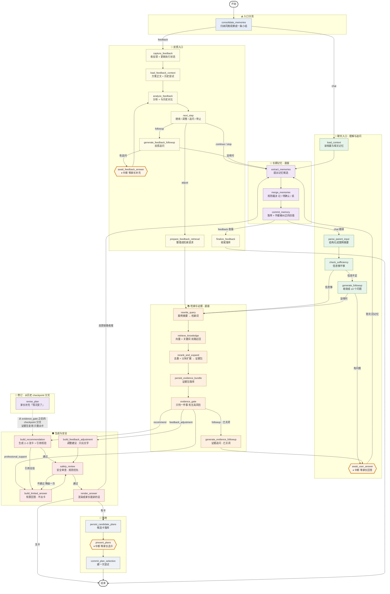

# 系统实现逻辑讲解（用户向）

> 用途：给别人讲这套系统现在是怎么跑的。
> 读法：先看第 1–3 节建立整体印象，再按第 4 节逐节点讲。
> 本文只讲"每个节点在解决什么问题"，不展开实现细节；节点对应的代码位置见附录 A。
>
> **本文对应 2026-10-27 的代码状态**（`rebuild/rdi-agent` 分支，HEAD `9f15779`）。
> 之后这一轮有三块大改动：记忆改成两层、证据门控改成"只挡高风险"、
> Time Travel 从调试能力变成产品能力（方案修订）。下面讲的都是改完之后的样子。

---

## 1. 一句话定位

这是一个给**孤独症谱系障碍儿童家长**用的"家庭干预教练"。
家长用自然语言描述孩子的情况，系统基于一本中文干预指南给出**可执行、可核对、有出处**的家庭干预建议，
并且在**风险过高、家长说的情况变复杂**的时候，诚实地拒绝给建议或把人引向专业支持。

它不是一个"什么都答"的问答机器人。这套系统的大部分设计，都是为了在**没有依据的时候不要假装有依据**。

---

## 2. 全局视图

整个系统是**一张 LangGraph 状态图**，有三个入口：

| 入口 | 触发方式 | 目的 |
|---|---|---|
| **聊天入口** | 家长发消息 | 理解情况 → 必要时追问 → 查指南 → 出建议卡 → 家长选一个 → 落地为"一次尝试" |
| **反馈入口** | 家长提交这次尝试的执行情况 | 分析执行效果 → 和历史对比 → 决定"继续 / 调整 / 追问 / 停止" |
| **修订入口** | 家长在反馈里补充"情况变了" | 从**上一次出方案之前**分叉，只重出方案卡，不重新问、不重新查 |

后两条入口共用三段公共能力：**长期记忆**、**知识库检索**、**安全审查**。

> 注：修订**不是图的第三个入口**。它在 API 层用 `aupdate_state(..., as_node=...)`
> 从**同一条会话线程**上"生成建议卡之前"的历史 checkpoint 派生一条分支，
> 证据包直接复用，只重跑"出卡 → 审查 → 渲染 → 落库"。图里画成一条虚线，是为了讲的时候好指。

图里有 **3 个中断点**（会暂停、等家长操作）：

- 追问中断：家长回答问题
- 方案选择中断：家长从 2–3 张建议卡里选一张
- 反馈追问中断：家长补充反馈里缺的信息

图里还有 **3 个环**（会走回头路）：

- 追问环：家长答完 → 重新并入事实 → 再判断够不够（**最多 1 轮**）
- 安全降级环：安全审查没过 → 降级为有限回答（只降一次）
- 反馈追问环：反馈太模糊 → 追问 → 重新分析（**最多 1 轮**）

**两个追问链的轮数是分开配的**（`FOLLOWUP_MAX_ROUNDS` 和 `FEEDBACK_FOLLOWUP_MAX_ROUNDS`，默认都是 1）。
理由很实际：家长在两个场景的耐心不一样 —— 开始时他对系统还不熟，
反馈时他已经跑完一轮、也知道自己当初答应了什么。用一个常量必然有一头不合适。

还有一个环**是关着的**：证据门控的追问。图上那条边还在，但**路由函数里根本没有"追问"这个分支**——
门控只算得出"转专业支持"和"出卡"两条路。理由和追问轮数一样：家长只被允许答一轮追问，
第二个圈会让两个环互相打转（门控说"缺信息" → 追问 → 回到充分性判断 → 检索 → 门控又说"缺信息"）。
现在证据不够就直接出卡，缺口写在卡里让家长看见。

### 2.1 一张图（讲解用的分区视图）



**颜色约定**（讲的时候照颜色分区讲最省事）：

| 颜色 | 分区 | 一句话 |
|---|---|---|
| 蓝 | 入口分流 | 归纳记忆小结，然后按 chat / feedback 分流 |
| 紫 | 长期记忆底座 | 两条入口共用的"记住这件事"的能力 |
| 绿 | 聊天 · 理解与追问 | 家长说了什么、够不够、要不要问 |
| 橙 | 检索与证据底座 | 查指南，产出可核对的证据包 |
| 红 | 生成与安全 | 出卡 / 兜底 / 审查 / 渲染 |
| 灰 | 落地 | 落库、让家长选、建一次尝试 |
| 黄 | 反馈入口 | 执行情况 → 下一步 |
| 深橙边 | **中断节点**（六边形） | 会暂停等家长，回调后从原地继续 |
| 紫虚线 | 修订分叉 | 不在图里，是 API 层从历史 checkpoint 派生的分支 |

**图怎么保证不是画错的**：

- `docs/系统图.mmd` —— 这张分区图的源文件
- `docs/系统图_自动生成.mmd` —— LangGraph 自己导出的原始图（未分区），用来对账

对账方式：把两张文件的边逐条解析成 `(起点, 终点)` 集合比较。
当前结果：**自动生成 46 条边，分区图 46 条边全部覆盖，零遗漏**；
分区图只多出 1 条 `REV → build_recommendation`（就是上面说的图外修订分叉）。

图会随代码变。重新对账的命令：

```bash
.venv/bin/python -c "from rdi_agent.graph.builder import build_graph; \
  open('docs/系统图_自动生成.mmd','w').write(build_graph().get_graph().draw_mermaid())"
```

---

## 3. 贯穿全图的四条原则

讲的时候这四条是重点，因为它们解释了图里很多"看起来绕"的安排。

### 原则一：路由由代码算，模型只能加严，不能放宽

"走哪条路""给不给建议卡"这种决定，**不能交给模型**。
模型在空证据上说"我觉得有依据"，正是系统最怕的事；
而更麻烦的是**同一份证据两次给出相反结论** —— 家长拿到什么成了掷骰子。

所以有几条是写死在代码里的，模型说什么都推翻不了：

- 家长报告了**严重**风险信号（自伤、伤人、拒绝进食进水等）→ 直接走专业支持
- 风险信号要**逐条再判一次**：模型把"到幼儿园门口大哭"也填成风险信号，
  而那一栏一旦非空就升级成"建议尽快就医"，等于让每个分离焦虑的孩子都被吓一跳。
  所以只有真的严重的（自伤、伤到别人、意识异常、拒绝进食进水）才算数。
- 没有片段达到"可作直接依据"的门槛 → 这份证据**不能**被标成"直接依据"

**只有高风险能挡住建议卡。** 证据不足**照样出卡** ——
卡上会标成"应用建议"（`ai_adaptation`）而不是"指南原文"，
哪一条是书里说的、哪一条是我们转化出来的，卡里分得清清楚楚。

模型能做的是**收紧**：它认为"高风险"，系统就按高风险走；
它认为"没问题"，但规则不允许，就还是不行。

**证据够不够支撑某一条具体建议，是引用校验管的**（见 4.1 ⑭），
不是门控管的。这两件事分开之后，门控才敢"不拦"。

### 原则二：事实是累积的，而且由代码兜底

- 家长第 2 轮补充的信息会**并进**第 1 轮的事实，不是覆盖。
- 家长明确**纠正**过的旧信息（比如"不是 4 岁，是 5 岁"），旧值会被标记作废，后续不再使用 —— 但历史留痕，家长随时能查、能改、能删。
- 模型抽取事实**只当补充来源**。系统额外用代码把"家长在追问里明确回答的内容"直接算进事实。
  原因很实际：实测模型会漏抽 —— 家长答了"没有不愉快的经历"，模型抽出来的事实里还是没有，
  于是下一轮它以为这件事没问过，换个说法再问一遍。**事实的完整性不能只靠模型。**
- 家长**这一轮原话里又提到**的、之前作废的内容，**不作废** —— 他这轮又说了，就是当前事实。

### 原则三：会暂停的节点必须是纯函数

LangGraph 恢复一个中断时，**包含中断的那个节点会整个重跑**。
所以：

- 追问节点、选方案节点**只读状态、只回状态**，不碰数据库；
- 所有写库动作都放在**中断之后**的独立节点里；
- 再加一层保险：所有业务写入都带 `turn_id` 唯一约束，重试不会产生第二条记录。

### 原则四：任何一步失败都降级，绝不编造

- 记忆服务挂了 → 这轮当没记忆，但家长的问题照答。
- 检索不到 → 照样出卡，但卡里说清"这一点我不确定"，不硬凑一个书名和页码。
- 模型生成失败 → 给一段有限回答，不返回 500。
- 引用校验不过（引用了不存在的片段/页码）→ **带错误信息重试一次**；
  仍不过就**把对不上的引用摘掉，卡片本身留着**（降级为"应用建议"，并在不确定性说明里写清），
  在运行轨迹里记下"引用校验失败"。**一张卡都生成不出来**才降级为有限回答。
- 安全审查拦下某张卡 → **只丢那一张**，其余照常给；全被拦下才退到有限回答。

原则四的核心是**"坏的部分单独处理，不要连坐"**。
连坐过一次的真实后果：三张卡里一张写法有问题，整组图被丢掉，
家长在追问之后一张都拿不到，前端还显示"证据不够" —— 那比给错更糟，因为方向完全指错了。

---

## 4. 逐节点讲解

### 4.1 聊天入口

#### ⓪ `consolidate_memories` —— 把同类观察归纳成一条小结（**整条链的第一站**）

放在**所有入口的最前面**，因为进 prompt 的观察记忆只有小结，
小结必须在"读上下文"之前就绪 —— 否则这一轮读到的还是上一版小结，合并的效果要晚一轮才看得到。

**为什么放轮首而不是写完就合**：写完就合会拖慢家长这一轮的回答；
而归纳出来的内容要等下一轮才真正进 prompt（prompt 是轮首读的），早合晚合对家长没有区别。

**失败一律降级**：合不了就用上一版小结（没有就当没小结），这一轮照常回答 —— 合并是增强项。

---

#### ① `load_context` —— 装上这个孩子已有的背景

读取这个孩子已有的**类目小结**（每个方面一条"目前是什么样"）、**家长的硬约束**、
**系统自己的推断**、**最近几次尝试**。
这些是"跨轮次的记忆"，让第二轮咨询不用从零问起。

**注意这里读不到原始短句** —— 短句只留在库里给家长看，不参与方案制定（见 4.4）。

**边界**：冷启动会话本来就没有历史，返回空是正常的，不是错误。读失败一律降级成薄上下文。

---

#### ② `extract_memories` —— 把家长这句话拆成短句，并归类

模型读完家长这一轮说的话（以及这一轮对追问的回答），做两件事：

1. **拆句** —— 把这段话拆成几个短句，**每句只讲一件事**
   （"在幼儿园哭而且不肯穿鞋"要拆成两句）。
2. **分类** —— 给每句归一个类目。

八个类目，从"最影响建议怎么写"排到"最不影响"：

| 类目 | 名称 | 决定建议的什么 |
|---|---|---|
| `separation` | 分离与过渡 | 怎么安排交接、分离、多久能适应 |
| `communication` | 沟通与表达 | 指令怎么说、说多复杂、要不要示范 |
| `social` | 社交与游戏 | 互动从哪里起手、要几个大人配合 |
| `emotion` | 情绪与调节 | 节奏、防崩预案、什么时候该停 |
| `sensory_motor` | 感觉与动作 | 环境怎么布置、活动用什么形式 |
| `daily` | 生活与自理 | 能落到哪些具体步骤、一次做几件 |
| `family` | 家庭与目标 | 方案的约束条件和可接受的取舍 |
| `other` | 其他 | 不改变建议的写法（年龄、诊断史等） |

**归类判据不是"这件事属于什么话题"，而是"它改变了建议的哪一部分"。**
"在幼儿园门口大哭"归 `separation`（它决定交接怎么安排），**不是** `emotion`。
按字面主题归类会把最关键的信息归错地方。

每条候选还带两个开关：

- **家长的偏好**（`is_preference`）—— 家长希望怎样、不希望怎样、能接受的取舍。
  这是**硬约束**，单独进 prompt，**不参与合并**（合并会把"不希望"的强度丢掉）。
- **系统自己的推断**（`inference`）—— 措辞必须是"可能……""看起来像……"。
  **照记，但标出来**，也**不参与合并**（合并会把猜测变成事实）。

它只负责"**提候选**"，不负责写库。能不能记，由下一个节点的纯规则决定。

---

#### ③ `merge_memories` —— 用纯规则决定"记 / 不记"

这一层**不调模型、只按规则跑**，保证同样的输入永远得到同样的结果。

**只有两档，没有"等家长确认"这一档。** 原因很实际：
面板就静静躺在右栏，没有任何地方提示家长去点 ——
于是"待确认"的内容永远不生效，家长明确说过的事，因为系统不敢替他做主，就当没发生过。
而一个带自闭症孩子的家长累了一天回来，还要逐条点"确认"，这产品就已经死了。

判定链（顺序即优先级）：

1. 内容过短 → **不记**（"好""嗯"存下来只会污染上下文）
2. 同一批里重复 → **不记**
3. 带诊断标签 → **不记**（系统不给孩子贴标签，记忆里也不存）
4. 库里已有同内容 → **不记**
5. **引不出家长的逐字原话 → 不记**（家长没法核对的东西，不能当记忆用出去）
6. 家长明确纠正旧记录 → 旧的标作废、新的写入
7. 模型说不记 → **不记**
8. 其余 → **记**

关键红线：**模型推断只能成为"待验证的假设"，永远不能直接变成事实。**
唯一的例外是家长明确纠正旧事实 —— 必须逐字引用、且不是推断，才允许直接生效，
否则一个过度保守的模型会让"纠正之后不再沿用旧值"永远不生效。

**模型只能往下压，不能往上抬**：模型说"值得记"但引不出原话 → 压掉；
模型说"不用记"→ 也不强行救回来。

---

#### ④ `commit_memory` —— 落库，并把"哪些旧值刚作废"交回状态

写业务表 + 写审计事件（memory_events），同时把被纠正/被删除的旧事实原文回传给下一步。

**为什么记忆在"理解家长说话"之前**：解析节点会把累积事实并进本轮，
如果先解析再记忆，家长刚纠正的旧值已经进了本轮事实，"作废"就来不及了。
所以顺序必须是**先记忆、后解析**。

---

#### ⑤ `parse_parent_input` —— 把这一轮的话变成结构化的"案例摘要"

把家长的自然语言整理成一份结构化摘要：观察到什么事实、家长的目标、已经试过什么、
还缺什么信息、**有没有风险信号**。

三份来源**相加**（不是覆盖）：上一轮累积的事实 + 这一轮模型新抽的事实 + 家长明确回答的问答对。

另外，**已作废的旧事实在这里被过滤掉**（事实、已试过、缺口、线索、上下文字典都要过一遍）——
家长纠正过的值不会被用上，而且不能从别的字段漏出去。
唯一不过滤的是**风险信号** —— 丢一次就可能漏掉"该找专业人士"的信号。

---

#### ⑥ `check_sufficiency` —— 判断"信息够不够"

这是**第一个门**：家长给的信息，够不够给出有意义的建议？

- 不够 → 去追问。
- 够 → 直接进检索出方案。

**上限是 1 轮**（`FOLLOWUP_MAX_ROUNDS`，可配）。
追问到上限就强制收手：继续追问的收益，已经低于"给一份标注了不确定性的建议"。
系统宁可给一个带"还不确定的地方"的建议，也不让家长陷在填表里。

**这一节点只调一次模型**，而且喂给它的不只是当前事实，还有"**之前问过什么问题、家长答了什么**"。
这是为了治一个具体的病：模型只看到问题列表时，分不清"这件事问过了"和"问过了但没答上来"，
两种情况它都会换个说法再问一遍。**把问答对给它，它才知道该基于新信息往下走。**

---

#### ⑦ `generate_followup` —— 把要问的问题收敛成最多 3 个

只问"**会改变建议**"的问题。每个问题带选项，家长点选或自己写。
如果模型发现已经没什么可问的，就直接跳到出方案，省掉一次空中断。

**这一轮问什么，是整轮里性价比最高的一次提问** —— 家长面前只有一次机会，
这一轮就该问最有用的那个，而不是分两次慢慢问。

---

#### ⑧ `await_user_answer` —— **中断点一**：等家长回答

图在这里**暂停**，状态被存盘，等家长答完再从原地继续，不会从头再来。
节点本身是纯函数（见原则三）。

它同时记下"这一轮问了什么、家长答了什么"，供下一轮判断使用。

**界面上追问是一张卡片，不是一句聊天消息。**
试过把追问改成普通消息，家长不认 —— 追问是"要你填的东西"，
长得就该像卡片，一眼能看出这是要你回答的，不是教练在聊天。
追问期间页面上那个输入框是**隐藏**的，免得家长在别处也打字、以为答错了地方。

---

#### ⑨ `rewrite_query` —— 把案例摘要变成检索请求

**纯规则，不调模型**。同一份摘要永远得到同一个查询 —— 否则检索指标的变化说不清是"检索变好了"还是"改写随机了"。

只使用**已确认的事实**去检索。模型推测的"这可能是社交动机问题"这类线索**不进检索词**：
拿假设去检索等于用假设验证自己。

关键词路还会做两件事：
- **分词**（jieba）—— 库里的全文索引是按空格分词的，查询侧必须同样分词，否则一片连写中文匹配不上
- **术语别名桥接** —— 家长说"发脾气"、指南写"挑战性行为"，靠一张显式的术语表桥过去

---

#### ⑩ `retrieve_knowledge` —— 双路召回

- **向量路**：语义相近（"孩子不肯进幼儿园"能对上"入园适应困难"）。
- **关键词路**：精确术语命中（指南里的专业词原样出现）。

两路结果用 RRF 合并。**默认不启用重排**——重排要把书里的原文片段发给外部服务，
而且实测重排会打散章节覆盖，召回反而下降（0.8529 → 0.8235）。

State 里只放**片段 id + 分数 + 章节 + 页码 + 一小段摘要**，不放完整原文（隐私和体积考虑）。

---

#### ⑪ `rerank_and_expand` —— 去重、补上下文，组装"证据包"

按 id 回库取完整片段，做父块扩展（把切碎的子块补回它所在的完整段落），
最后组装成一份**证据包**：这份回答依据了指南里的哪几段、每段在哪一章哪一页。

同时做"可用性"判定：哪些片段**可以当直接依据**（关键词路命中了精确术语，
或者向量相似度达到门槛），哪些只是"相关度不够、只能作参考"。

---

#### ⑫ `persist_evidence_bundle` —— 证据包落库

把证据包存下来。之后任何时候都能回答："**当时这份回答依据的是哪几段内容**"。

有限回答（没给建议卡的那一路）同样检索过、同样有依据，所以这一步不能挂在"写建议卡"的节点上。

---

#### ⑬ `evidence_gate` —— **第二个门**：依据够不够、是不是高风险

模型在这里只**描述证据**：够不够直接、能支撑哪些主张、缺什么、有没有高风险。

**走哪条路由由代码算**（`decide_flow`），不由模型说。只有两条出口：

- `professional_support` → 不出卡，引导找专业人士（**只有高风险能走这条**）
- `recommend` → 出建议卡（其余一律走这条，包括**一条证据都没有**的情况）

**为什么"证据为空也照样出卡"**：证据够不够支撑一条具体建议，
由引用校验（⑭）把关 —— 编造引用会被摘掉，卡片降级为"应用建议"。
门控只负责"有没有必须马上转专业支持的风险"。
让门控同时管两件事，就会出现"家长拿到什么成了掷骰子"。

**规则先跑**：家长报了严重风险信号时，**压根不调模型**。

---

#### ⑭ `build_recommendation` —— 生成 2–3 张建议卡，并做引用校验

一张建议卡包含：做什么、在什么场景下做、分几步、**看什么指标判断有没有效果**、
**什么情况下减量或停**、**哪些地方还不确定**。其中"观察指标"和"停止条件"是**强制的**——
schema 层面不允许缺。

**引用校验是硬闸**，查三件事：
模型在卡里引用的每个来源，都必须能在本次证据包里找到对应片段，页码要对得上；
片段里提到的**指南术语**必须真的出现在它引用的那些片段里（术语在别的片段里有不算——
挂错证据和编造一样是错的）；标成"指南原文"的卡，带术语的片段必须挂证据
（说"这段是指南里的"却不指出是哪一段，家长核不了）。
**这是"编造引用必须失败"的测试所保证的行为。**

失败处理（**注意不是丢卡**）：

1. 带错误信息**重试一次**（把具体的错处告诉模型，让它改）
2. 仍不过 → **把对不上的引用摘掉**，卡片保留，`application_label` 降为 `ai_adaptation`，
   并在"不确定性说明"里写明"本卡的引用未通过校验，以下是结合您描述的情况做的应用建议，不是指南原文"
3. 一张卡都生成不出来 → 才降级为有限回答

理由很实在：家长要的是**能执行的动作**。一条出处对不上，不代表整张卡没用。
直接丢掉会让家长在三轮追问之后只拿到一段文字。

---

#### ⑮ `build_limited_answer` —— 依据不足或高风险时的有限回答

**这一路不出建议卡**。证据不够还给一张"看起来很专业"的卡，等于用格式唬人。
只给文字：能先做的低风险观察、这周该留意什么、什么时候该找专业人士、以及**缺口在哪**。

有两种模式：`limited`（依据不足）和 `risk`（家长报了风险信号）。

**降级只做一次**。如果允许无限降级，就会出现"审查不通过 → 降级 → 再审查 → 再降级"的死循环。

---

#### ⑯ `safety_review` —— 安全审查

**规则是硬闸，模型复核只能加严。** 检查包括：

- 有没有出现诊断性结论、把孩子贴标签
- 有没有建议强迫眼神接触、压制拒绝、忽视明显不适
- 有没有缺少停止条件
- 有没有大段照抄原文
- 有没有把 AI 的转化建议说成"指南原话"

三种结果：

- `pass` → 继续渲染
- `blocked` → 换成安全兜底话术
- `needs_human_review` → 降级为有限回答并标记（首版不建人工审核队列）

**逐卡丢弃**：命中规则的是**某一张卡**，不是整组图。
把命中的那张单独丢掉，剩下的重新审一遍确认干净，被丢的如果是推荐卡就补一个推荐位。
全被命中才退到有限回答。

**前端要说清少在哪**：状态报 `safety_blocked` 并写明"拦了几张、为什么"——
不能一律报"证据不够"，那会把家长引到完全错误的方向。

---

#### ⑰ `render_answer` —— 渲染成家长能读的话

**纯函数，不调模型**——输出确定、可复现，也省一次模型往返。
有卡就渲染卡片（先做哪张、怎么做、留意什么、依据在哪），没卡就渲染有限回答。

---

#### ⑱ `persist_candidate_plans` —— 候选卡落库

**在中断之前就写**。家长可能看到卡之后直接关掉浏览器再也不回来，这一轮的分析不该丢掉。
写的是"待选"状态，真正选中由下一个节点改。

每张卡都挂上**证据包 id**，所以任何一张卡都能追溯到"当时依据的是哪几段内容"。
同时记下**这一版是第几版**、以及**生成它之前的那个 checkpoint**（下次修订从这里分叉）。

---

#### ⑲ `present_plans` —— **中断点二**：把卡交给家长选

图在这里暂停。家长点选一张，这张卡就成为"接下来一周要做的事"。

---

#### ⑳ `commit_plan_selection` —— 落地这次选择

把选中的卡标成"已选"，**建一次"尝试"记录**（这次要做的事、针对哪个孩子、属于哪个版本）。
幂等：同一个方案重复提交不会产生第二条尝试。

同时把刚才渲染好的回答保留在对话里——家长刚看到建议就被换成一句话，等于把内容从对话里抹掉了。

---

### 4.2 反馈入口

家长执行了一周，回来告诉我们实际发生了什么。

#### ① `capture_feedback` —— 收下这次反馈

写一条反馈记录，并**更新这次尝试的执行状态**（已尝试 / 没做 / 中途停了）。

**执行和结果分开记**："做了什么"和"观察到什么"是两回事。家长说"今天没哭"是一条观察，
不等于上一周的方案有效——一次观察说明不了因果。

**没做和中途停止同样有价值**，不能当成"方案无效"丢掉。
只有**首次提交**才更新执行状态，重发旧反馈不会把后来更新的状态改回去。

**这条记录先落库，再去分析** —— 分析失败时家长写的东西不会丢，
重试同一个 `turn_id` 会命中缓存路径。

---

#### ② `load_feedback_context` —— 把这次尝试的上下文装齐

读四样东西：这次方案的原正文和版本、孩子的档案、长期记忆、**这个孩子过去的尝试历史**。

有了历史，才能回答"这次和上次有什么不同"。任何一块读不出来都降级成空，不耽误给家长下一步。

---

#### ③ `analyze_feedback` —— 分析执行情况，并和历史对比

分析四件事：实际执行情况、观察到的变化、执行困难、还没确认的问题。

**只描述观察到的关系，不下因果结论**。不会因为孩子这周情绪好，就说"是这个方案起了作用"。

结果立刻落库，重试同一个 `turn_id` 时直接读缓存，不再跑一次模型。

**家长写的是一段话，不是六个格子。** 所以分析那一步的 prompt 明说：
"家长把执行情况、孩子反应、卡住的地方都写在一段里，你来拆，靠内容判断不要按位置"。
不改的话，模型会对着空的"孩子反应"栏脑补出根本没发生过的事。

---

#### ④ `next_step` —— 四选一：继续 / 调整 / 追问 / 停止

| 决定 | 含义 | 后续 |
|---|---|---|
| `continue` | 继续当前方案 | 收尾 |
| `stop` | 先停一停 | 收尾（会明确告诉家长"这次先停一停，不用勉强继续"） |
| `followup` | 反馈太模糊，还不能判断 | 追问一轮 |
| `adjust` | 信息明显变了，或原方案根本没法执行 | **重新查指南**，基于证据给一段调整建议 |

**"只是没感觉出效果"不足以改方案**——那可能只是需要更多时间。

---

#### ⑤ `generate_feedback_followup` / `await_feedback_answer` —— 反馈追问（最多 1 轮）

反馈太模糊时，问最多 3 个**会改变建议**的问题。中断等家长回答，答完回到分析。
上限 1 轮（`FEEDBACK_FOLLOWUP_MAX_ROUNDS`，可配）：家长也会觉得在填表。

---

#### ⑥ `prepare_feedback_retrieval` —— 把反馈整理成检索请求

反馈入口没走过"理解家长说话"那一步，所以这里用**代码**确定性地拼一份案例摘要出来。
不打 LLM，保证同一份反馈永远得到同一个查询。

---

#### ⑦ `build_feedback_adjustment` —— 给出调整建议

复用聊天入口的整条检索链（查指南 → 证据包 → 门控），但**只出文字，不出新卡、不建新尝试**。

理由很实际：反馈迭代调整的是**正在执行的那一条**；再甩 2–3 张新卡，家长会不知道该继续哪条。

提到指南术语的每一句，都要能落到本次证据包里的具体片段上；落不上的句子**直接丢掉**——
挂错证据和编造引用一样，不能给家长看。

---

#### ⑧ `extract_memories` → `merge_memories` → `commit_memory` —— 反馈也进记忆

反馈里的"孩子反应""执行困难"正是**观察**的来源。反馈的原文由家长自己写，
所以抽取时只喂家长写的那些字段，**不把模型的转述当家长原话**（那是让模型给自己作证）。

---

#### ⑨ `finalize_feedback` —— 收尾

把这一轮的结果（状态、给家长的最终文字、走的哪条路、依据的证据包）统一落库。
API 看到"已完成"就直接返回缓存，不再重跑模型。

**反馈提交是流式的**：走 SSE，边跑边推进度（"正在分析你的反馈…"），
家长看到的是"它在做什么"，而不是一个不动的按钮。
推的是**步骤进度**，不是半截答案 —— 结构化输出下模型吐出来的是半截 JSON，家长看不懂。

---

### 4.3 修订入口（Time Travel 变成产品能力）

**问题**：家长执行一周后回填反馈，才发现"情况有变"——原来计划早上送园，
现在只有晚上有时间；原来以为孩子怕分离，后来发现怕的是声音。
重新开一段对话，前面问清的事实、找到的指南依据全部作废；接受现有方案又是在给一份不贴合当前情况的建议。

**做法**：从**生成建议卡之前**的历史 checkpoint 派生同线程分支，
只重跑"生成卡 → 安全审查 → 渲染 → 落库 → 等家长选"，其余全部沿用。

```text
理解（问清什么）─┐
取证（找到什么）─┼─→ ★ 分叉点 → 生成建议卡 → 安全审查 → 渲染 → 落库 → 等家长选
门控（够不够）──┘
```

- **复用**：记忆上下文、充分性判断/追问、查询改写/检索/重排/父块扩展、
  证据包落库、证据门控结论。家长不会被重新问，也不会重新查指南。
- **重跑**：生成建议卡、安全审查、渲染、候选卡落库、选卡中断、选定建 trial。
- **同一条会话线程**：分叉落在原 thread 上，选卡仍复用同一个选卡接口，不新增中断类型；
  调试面板的 checkpoint 历史里自然出现分支。

**三条必须配套的规则**：

1. **新信息并进事实要在接口层做，不能让图自动跑。** 图里的解析节点排在充分性判断之前；
   要让它跑，分叉点就得往前挪，家长又会被重新问一遍。
   所以接口直接调用一个纯函数，把新情况作为"家长补充"通道塞进已累积的事实里，
   同时传入作废事实清单保留原有过滤。
2. **新信息里的风险信号必须复查。** 门控不重跑，"孩子最近开始打人"这类新风险不会被发现。
   接口层用纯规则（零模型调用）判一次；命中就把裁决改写成"转专业支持"，路由自动改道，不出卡。
3. **卡号必须带版本前缀。** 模型写死的 `plan_1/plan_2/plan_3` 会和旧卡撞号，
   落库时把新卡当成"已存过"直接跳过，家长选到的还是旧卡。
   第 1 版保持原样，第 2 版起用 `r2_plan_1`；前缀在生成提示里就告诉模型，代码再做一次兜底归一。

**数据**：方案表加了"产生这一版的轮次"（同时做幂等键）和"分叉起点"两列。
旧版本的卡和旧 trial 都不删，前端按版本分组，旧版标"已归档"。

**幂等**：同一个 `turn_id` 重复提交只返回已有结果，不产生第二条分支。

---

### 4.4 长期记忆的内部结构（两层）

这是整套系统里最该被怀疑的一层，所以它被拆成**两层 + 三个纯规则文件**。

```text
家长这段话
   ↓ ② extract_memories（模型）
短句列表：每句只讲一件事 + 一个类目 + 两个开关（偏好/推断）
   ↓ ③ merge_memories（纯规则）
memory_items 表：留下的短句
   ↓ ⓪ consolidate_memories（轮首，模型归纳）
每个类目一条小结  ← 只有它进 prompt
```

**为什么曾经的三层（事实/观察/假设）被废掉**：抽取那一步要模型判断"这条是事实还是观察还是假设"，
实测它**几乎总是判成"事实"** —— 于是观察表永远是空的，假设表也永远是空的。
而且三层让"这条记忆怎么用"取决于它被归成哪一类，而不是取决于它说了什么。
家长说的"在幼儿园门口哭"和"我不希望他被批评"都是他说的，
但后者是**硬约束**，合并进去会把"不希望"的强度丢掉。

**现在进 prompt 的只有三样**：

| 键 | 是什么 | 怎么裁剪 |
|---|---|---|
| 小结 | 每个类目一条"目前是什么样" | 按与本轮问题的相关度排 + 字符预算 |
| 家长的偏好 | 硬约束 | **不裁剪**（漏一条代价最大） |
| 系统的推断 | 猜测，标成未验证 | 相关度 + 最多 4 条 |

**原始短句不参与方案制定**，只留在库里给家长看。

**合并的两个门槛**（写死在一个文件里，调一个就要重跑一堆用例）：

- 同一个类目下至少 **3 条**明细 —— 两条很可能只是巧合，归纳不出"模式"
- 至少来自 **2 个不同的轮次** —— 这是防"假模式"最关键的一条：
  家长一段话里能抽出三四条观察（"哭了""抱腿""说不想去"），
  凑够 3 条就归纳，等于把一次事件说成"孩子每次都这样"。**跨轮次才是"多次出现"。**

不够格也要出小结，只是内容是明细的**直接复述**，不引入任何新断言。
这条很重要：家长第一轮就说了"在幼儿园门口哭"，这时候还没到 3 条，
没有"直接复述"这一档，这句话就永远进不了 prompt —— 而它恰恰是分离场景里最该被用上的信息。

**什么时候要重算**：判据是"**现有小结有没有覆盖这个类目现在的全部明细**"，不是"有没有新增几条"。
只按新增数判断的话，**一条新明细会一直落空** —— 它既没被旧小结覆盖，
又不够触发重算，于是永远进不了 prompt。漏掉一条明细，就是家长说过的一句话白说了。

**归纳失败不丢东西**：模型挂了 → 退回"直接复述"。任何一个类目都不会因为一次合并失败就变成空白。

**归纳必须带成立条件**（"在幼儿园门口""连续三天以上"）。
没有条件的小结会被读成"孩子就是这样" —— 而几条记录不足以支撑这种断言。

**家长想推翻某条记忆**，有两条路，都不用进面板逐条点：
在对话里说"不是这样"（走纠正链路），或者在面板里删掉它。

**面板上看到的是什么**：按类目分组的**小结**，
点开"由 N 句归纳而来"能看到归纳自的哪几句原话 —— 归纳不是黑盒。

---

### 4.5 调试（阶段 5）

| 接口 | 作用 |
|---|---|
| `GET /api/debug/conversations/{id}/state` | 看当前状态摘要（脱敏） |
| `GET /api/debug/conversations/{id}/checkpoints` | 看历史检查点 |
| `POST /api/debug/conversations/{id}/fork` | 从某个历史检查点派生一条独立分支 |

**分支不写业务表**。调试时改一个情境变量再跑一遍，如果照样写方案/尝试/记忆，
现实数据就会被"假设的另一种做法"污染，家长下次看到的是调试结果。
所以调试分支会跳过所有业务写入，界面上也会标记"这一轮跑了但什么都没落库"。

**修订接口用的是另一套机制**（4.3）—— 它**要**写业务表，
因为它是一条真实的产品路径，不是调试。

---

### 4.6 运行参数（手动测试台）

模型名和超时是**最常被临时改的两项** —— provider 排队时把超时调短试试、
换个模型对比一下效果。改 `.env` 要重启服务，改代码更糟。

所以这两项做成了**运行时可改**：

- 前端顶栏那个 LLM 标记点开就能改模型名和超时，**立刻生效，不用重启**
- 改超时必须**重置 client** —— client 是按超时缓存的，不重置等于没改
- 覆盖只存在**进程内存**里，重启就没了，所以配一个"回到默认"
- **只开放这两个字段**：数据库地址、检索后端这些改了就是换一套系统，不是"调一下参数"，它们留在 `.env` 里

**重试次数默认 2 次**。超时 120 秒 × 3 次 = 最坏 6 分钟，家长面对一个不动的按钮；
2 次是"还值得再等等"的上限。

**出错要说人话**：没接住的异常默认返回 `Internal Server Error`，
家长什么都不知道，调试的人还得翻日志才知道是模型超时了。
所以有一个全局异常处理器，把异常类型和消息带回前端
（**只给本地手动测试台用**，线上不能这么干，消息里可能有孩子的信息）。

---

## 5. 用户视角的四种结局

讲的时候可以这样收尾——不管走哪条路，系统只有四种结局，而且**每一种都诚实**：

| 结局 | 什么时候 | 用户看到什么 |
|---|---|---|
| **给建议卡** | 信息够 + 安全审查通过 | 2–3 张卡，每张含步骤、观察指标、停止条件、指南章节页码；点一张即开始一次尝试 |
| **有限回答** | 建议卡一张都没生成出来，或全被安全审查拦下 | 明确说"知识库里没找到足够依据"，给能先做的低风险观察，标出缺口，**不给卡** |
| **引导找专业人士** | 家长报告了严重风险信号 | 停止给干预方案，说明原因，给求助建议 |
| **追问** | 信息不足 | 最多 3 个问题（带选项），答完从原处继续，不从头再来 |

另外，反馈入口还有第五种：**基于新证据的调整建议**（只出文字，不出卡）。

**"有限回答"不再等于"证据不够"**。这两个要分开报：
一张卡被安全审查拦下和"书里没写"，是完全不同的两件事。
报错了会把家长引到完全错误的方向去 —— 而家长是照着这个提示决定下一步的。

**界面上还有一条原则**：给家长看的东西要少而清楚。
长期记忆面板只显示按类目分组的小结（"家长的要求"和"系统的推测"暂时收起）；
调试面板和原始响应默认收起；反馈表单只有一个对话框；
追问是一张卡片而不是聊天消息。
每一处"多出来的"都在制造"我该看哪个"的犹豫。

---

## 6. 已知边界（讲的时候主动说，比被问出来好）

1. **检索的中文同义表述对不上**。
   分词已经做了（入库和查询两侧都用 jieba，形态一致），但"一周"和"每周"仍是两个不同的词元。
   评测里 34 条相关用例有 5 条没命中，根因就在这里 —— **不是融合权重的问题**。
   加权 RRF、每章节限 1 块、只走向量路、只走关键词路，全试过，都更差。
   下一个该做的是补同义词和字面兜底，不是调权重。

2. **重排当前是关的**。实测开着会打散章节覆盖，召回从 0.8529 掉到 0.8235。

3. **知识库目前是一本书**（25 页、129 个片段、22 个章节）。
   多来源融合、独立向量库、BM25 扩展都在范围之外。

4. **记忆只在新抽的短句上生效**。改成两层时，老的三层数据**没有迁移** ——
   三层的老记录语义和新短句对不上，硬搬过来只会得到一堆归错类的句子。开发阶段直接丢掉。

5. **修订只能改"出方案之前"的事实**。分叉点之后的东西（已经生成的卡、旧的审查结论、旧的选择）
   一律重跑，不带过来 —— 否则新旧版本会互相污染。

6. **运行时的模型名/超时覆盖不持久**。重启就回到 `.env`。

7. **调试分支不能覆盖正式记忆**，但 Time Travel 的"一键对比两种方案"还没做成成品流程 ——
   修订接口已经能出多版本卡，但并排对比的界面还没有。

---

## 附录 A：节点 → 代码位置

| 节点 | 文件 |
|---|---|
| 图装配 | `rdi_agent/graph/builder.py` |
| 状态定义 | `rdi_agent/graph/state.py` |
| Checkpointer / 图单例 | `rdi_agent/graph/runtime.py` |
| `load_context` / `parse_parent_input` / `check_sufficiency` / `generate_followup` / `await_user_answer` / `build_recommendation` / `present_plans` | `rdi_agent/graph/nodes/chat_nodes.py` |
| `rewrite_query` / `retrieve_knowledge` / `rerank_and_expand` / `evidence_gate` / `build_limited_answer` / `safety_review` / `render_answer` | `rdi_agent/graph/nodes/retrieval_nodes.py` |
| `capture_feedback` / `load_feedback_context` / `analyze_feedback` / `next_step` / `build_feedback_adjustment` / `finalize_feedback` | `rdi_agent/graph/nodes/feedback_nodes.py` |
| `consolidate_memories` / `extract_memories` / `merge_memories` / `commit_memory` | `rdi_agent/graph/nodes/memory_nodes.py` |
| `persist_evidence_bundle` / `persist_candidate_plans` / `commit_plan_selection` | `rdi_agent/graph/nodes/write_nodes.py` |
| 证据门控规则层 | `rdi_agent/graph/evidence_gate.py` |
| 引用校验 | `rdi_agent/graph/citations.py` |
| 事实合并纯函数（修订入口共用） | `rdi_agent/graph/facts_merge.py` |
| 安全规则 | `rdi_agent/graph/safety.py` |
| 调试写保护 | `rdi_agent/graph/write_guard.py` |
| 记忆类目与合并判据 | `rdi_agent/memory/categories.py` |
| 记忆规则与编排 | `rdi_agent/memory/`（`merge.py` / `service.py` / `summaries.py` / `ids.py`） |
| 检索管线 | `rdi_agent/rag/` |
| 进度事件 | `rdi_agent/progress.py` |
| HTTP 接口 | `rdi_agent/api/`（`conversations.py` / `revision.py` / `settings.py` / `memory.py` / `debug.py`） |

---

## 附录 B：可以现场演示的路径

1. **信息不足** → 系统追问 → 补充后恢复 → 给出 2–3 张卡（演示"中断 + 恢复"）
2. **有直接依据** → 卡上出现章节和页码 → 用 PDF 翻到同一页核对（演示"可追溯"）
3. **知识库没有答案** → 明确说"没有足够依据"，不出现任何虚构书名/页码（演示"会拒答"）
4. **家长报了风险信号** → 不再给干预方案，转向专业支持（演示"安全边界"）
5. **第二轮补充事实** → 系统主动使用第一轮记下的信息；家长纠正一条旧信息 → 后续不再沿用旧值（演示"长期记忆"）
6. **情况变了** → 在反馈里补充"只有晚上有时间" → 出第 2 版方案卡，全程没有重新追问（演示"Time Travel"）
7. **一处引用对不上** → 卡片保留但降级为"应用建议"，不确定性说明里写明（演示"坏的部分单独处理"）
